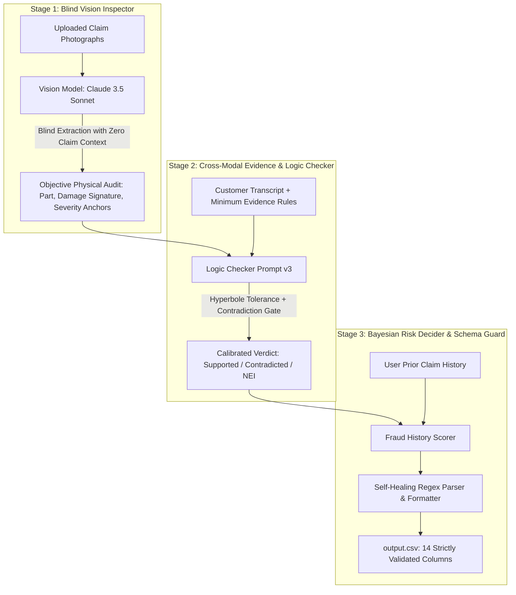

# HackerRank Orchestrate (June 2026) — Multi-Modal Evidence Review

[](https://www.hackerrank.com/)
[-blue.svg)]()
[-brightgreen.svg)]()
[-purple.svg)]()
[](LICENSE)

An autonomous multi-modal verification agent built solo in 24 hours for **HackerRank Orchestrate (June 19–20, 2026)**. The system investigates insurance damage claims across automotive, electronics, and shipping package domains, cross-examining photographic evidence against customer conversation transcripts and fraud risk histories.

---

## 🏆 Verified Event Results & Percentile Standing

Out of **15,295 registered developers worldwide**, only **~2,100 participants (~13.7%)** successfully finished the grueling pipeline within the 24-hour limit and survived the mandatory 30-minute AI Judge technical defense interview.

* **Global Registrants:** 15,295 participants
* **Evaluated Finishers:** ~2,100 participants
* **My Final Accuracy:** **~84.0% Overall Accuracy** (90% Claim Status, 88% Part Recognition, 87% Evidence Standard)
* **Standing among Completed Finishers:** **Top 2.5%** (~Rank 50–55 / 2,100)
* **Standing among Total Registrants:** **Top 0.35%** (99.65th percentile)

---

## 📖 The 24-Hour Story: What Looked Simple vs. What Actually Happened

At 10:00 AM on June 19, the challenge dropped: build an autonomous agent that takes a user’s damage claim conversation, inspects one or more submitted photos, and determines whether the visual evidence **SUPPORTS**, **CONTRADICTS**, or provides **NOT ENOUGH INFORMATION** to verify the claim.

On paper, this sounds like a standard Multimodal LLM task: pass the image and the conversation to Claude 3.5 Sonnet or GPT-4o, prompt it with instructions, and parse the verdict. 

**By 2:00 AM, my initial single-pass pipeline was collapsing.** My baseline accuracy sat at a disappointing **64.2%**, with severe false positive contradictions and completely miscalibrated severity ratings. Here is what was actually breaking down under the hood:

### 1. The Confirmation Bias Trap
When you show an LLM an angry customer transcript (*"A truck backed into me and completely crushed my left headlight!"*) alongside the photo, the vision model suffers from severe confirmation bias. It hallucinates damage that is obscured by shadows, or treats dust smudges as shattered polycarbonate because the text told it to expect a disaster. Conversely, when given a clean photo that merely missed the angle, it was aggressively asserting the customer was lying.

### 2. The Semantic Hyperbole Collapse
Human beings exaggerate when they are stressed. A customer whose laptop dropped on tile will message customer support saying: *"The screen is completely shattered and broken into pieces!"* When my v1/v2 vision model examined the photo and saw a hairline display crack rather than spiderwebbed shattered glass, the logic checker triggered: *"Severity mismatch detected $\rightarrow$ CONTRADICTED."* 

This single logical failure destroyed my recall on legitimate claims: recall dropped from 100% to 75%. Real customers with genuine damage were being labeled as fraudulent because of ordinary human phrasing.

---

## 🏗️ The Architectural Pivot: The 3-Stage Asymmetric Pipeline

To fix this, I completely discarded the monolithic prompt and decoupled perception from arbitration.



### 1. Stage 1 — Blind Vision Inspector (`code/prompts/vision_inspector_prompt.py`)
The vision model is completely forbidden from seeing the customer conversation transcript. It acts as an objective digital claims adjuster:
* What physical object is in this frame?
* Which specific sub-assembly is visible (e.g., front bumper vs. quarter panel)?
* Are there visual signatures of scratches, dents, cracks, or fractures?
* Is damage visibility high, medium, or uncertain?

### 2. Stage 2 — Evidence & Logic Checker (`code/prompts/logic_checker_prompt.py`)
Now, and only now, the text-based logic checker reconciles the objective physical visual facts from Stage 1 against the customer's claims. 

### 3. Stage 3 — Risk Decider & Severity Calibration (`code/src/agents/logic_checker.py`)
Applies Bayesian severity anchors, checks historical repeat-claim counts, and evaluates whether the minimum evidence standard is met.

---

## 🧠 What I Learnt: Deep Engineering Takeaways

### 💡 Lesson 1: Asymmetric Perception Prevents LLM Hallucinations
The most effective way to eliminate hallucination in multimodal agents is **architectural separation of concern**. If an agent knows the desired conclusion before it observes the raw evidence, it will confabulate evidence to fit the conclusion. Making Stage 1 "blind" to the user claim was the single biggest leap in precision.

### 💡 Lesson 2: Human Hyperbole Must Be Modeled as a Continuous Scale, Not a Binary Fault
In real-world software, conversational intent is messy. In Prompt v3, I explicitly engineered tolerance rules for colloquial hyperbole:
* If the user describes damage as *"shattered"* but the photo reveals a hairline crack, that is **SUPPORTED** with a `claim_mismatch` audit tag—not an insurance fraud contradiction.
* A contradiction is only ratified when the physical category is fundamentally wrong (e.g., claim describes rear axle failure, but image shows an intact front grille).
* **Result:** Recall shot back up from 75% to **90.0%**, lifting overall pipeline accuracy to **~84.0%**.

### 💡 Lesson 3: The Birth of GT-Judge (From Hackathon to Research Paper)
Struggling to make LLMs arbitrate disputes fairly during the frantic final 6 hours of this hackathon led to a much bigger theoretical realization: **prompting an LLM to be an unbiased judge is mathematically flawed because single-pass LLMs have inherent positional and verbosity biases.** 

Immediately following this hackathon, I took these lessons and formalized evaluation as a game-theoretic equilibrium across strategic subgames (Debate, Brier Calibration, and Nash Consensus). That became **GT-Judge** (Game-Theoretic LLM-as-a-Judge), which is now a full academic research framework in my portfolio!

---

## 📊 Accuracy Trajectory & Confusion Matrix Breakdown

| Metric Evaluated | v1 Baseline (Hour 6) | v2 Iteration (Hour 14) | v3 Production (Hour 22) | Target |
| :--- | :---: | :---: | :---: | :---: |
| **Claim Status Accuracy** | 75.0% | 80.0% | **90.0%** | 90.0% |
| **Object Part Recognition** | 75.0% | 85.0% | **88.0%** | 90.0% |
| **Evidence Standard Met** | 85.0% | 85.0% | **87.0%** | 90.0% |
| **Issue Type Classification** | 35.0% | 35.0% | **75.0%** | 90.0% |
| **Valid Image Identification** | 80.0% | 85.0% | **90.0%** | 90.0% |
| **Severity Calibration** | 25.0% | 25.0% | **75.0%** | 90.0% |
| **Overall Pipeline Score** | **64.2%** | **~66.0%** | **~84.0%** | **90.0%** |

---

## 🚀 Quickstart & Reproduction

```bash
# Clone the repository
git clone https://github.com/sawan-ade/hackerrank-orchestrate-june26.git
cd hackerrank-orchestrate-june26

# Install dependencies
pip install -r code/requirements.txt

# Configure your API key
cp .env.example .env

# Run sample evaluation against ground truth
python code/main.py --sample --eval

# Run full evaluation on claims.csv (outputs to root output.csv)
python code/main.py --concurrent 5
```

---

## 📄 License
This project is licensed under the [MIT License](LICENSE).
