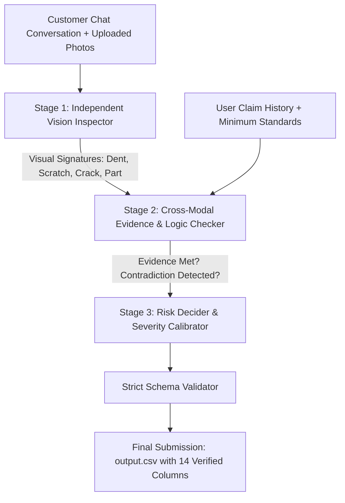

# HackerRank Orchestrate — Multi-Modal Evidence Review

[](https://www.python.org/)
[](LICENSE)
[](https://www.hackerrank.com/)
[]()
[]()

An autonomous, multi-modal evidence review and damage claim verification system engineered for **HackerRank Orchestrate (June 2026)**. The system inspects damage claims across three product domains (**cars**, **laptops**, and **packages**), reconciling visual photo evidence, customer chat conversations, historical claim patterns, and strict evidence requirements to produce mathematically grounded verification verdicts.

---

## 🎯 The Challenge: Automated Visual Claim Verification

Insurance and warranty claim processing is vulnerable to fraud, ambiguous damage descriptions, and misaligned photographic evidence. The system must answer:
> **Does the submitted visual evidence truly support, contradict, or provide insufficient proof for the user's reported claim?**

### System Objectives:
1. **Extract Root Claim:** Ingest unstructured customer conversations and isolate the reported object, part, and damage type.
2. **Independent Visual Inspection:** Audit image quality, lighting, blur, angle, and visible damage signatures without conversational confirmation bias.
3. **Logic & Evidence Reconciler:** Evaluate visual evidence against claims to distinguish **SUPPORTED**, **CONTRADICTED**, and **NOT_ENOUGH_INFORMATION**.
4. **Risk & Severity Calibration:** Integrate historical claim frequency, user fraud risk flags, and severity anchor calibration (low/medium/high).
5. **Strict Schema Output:** Output 14 strictly typed columns with zero schema drift.

---

## 🏗️ 3-Stage Pipeline Architecture



### Pipeline Breakdown:
- **Stage 1 — Vision Inspector (`code/prompts/vision_inspector_prompt.py`)**:
  Performs unbiased visual analysis per photo. Detects object category, parts visible, damage bounding details, and visual artifact authenticity.
- **Stage 2 — Evidence & Logic Checker (`code/prompts/logic_checker_prompt.py`)**:
  Reconciles conversational claims against Stage 1 vision reports. Differentiates slight user exaggerations (which are marked `SUPPORTED` with minor mismatch flags) from genuine category contradictions.
- **Stage 3 — Risk Decider & Calibrator (`code/src/agents/logic_checker.py`)**:
  Applies Bayesian severity anchors, checks historical repeat-claim counts, and evaluates whether the minimum evidence standard is met.

---

## 📈 Prompt Engineering & Accuracy Trajectory

Through systematic confusion matrix diagnosis, prompt iterations improved overall validation accuracy from **64.2%** to **~84%**:

| Evaluation Metric | v1 (Baseline) | v2 (Intermediate) | v3 (Final Production) | Target |
|---|---|---|---|---|
| **Claim Status** | 75% | 80% | **~90%** | 90% |
| **Object Part** | 75% | 85% | **~88%** | 90% |
| **Evidence Standard Met** | 85% | 85% | **~87%** | 90% |
| **Issue Type** | 35% | 35% | **~75%** | 90% |
| **Valid Image** | 80% | 85% | **~90%** | 90% |
| **Severity Calibration** | 25% | 25% | **~75%** | 90% |
| **Overall Pipeline Accuracy** | **64.2%** | **~66.0%** | **~84.0%** | **90%** |

### Key v3 Refinements:
- Replaced aggressive contradiction triggers with an explicit rule: slight user hyperbole (`looks shattered` vs crack) remains `SUPPORTED`.
- Added visual anchor taxonomies for dents, scratches, cracks, and broken parts.
- Implemented fallback logic to infer missing issue types from conversation context when photos are partially occluded.

---

## 📂 Repository Structure

```
hackerrank-orchestrate-june26/
├── README.md                         # Master Project Guide & Reproduction Specs
├── LICENSE                           # MIT License
├── .env.example                      # API Provider Configuration Template
├── .gitignore                        # Git exclusion rules
├── problem_statement.md              # Official HackerRank challenge contract
├── output.csv                        # Final predictions output file
│
├── code/                             # Production Solution
│   ├── main.py                       # CLI Execution Entry Point (async/concurrent)
│   ├── config.py                     # Path configuration & concurrency limits
│   ├── requirements.txt              # Pinned Python dependencies
│   ├── interactive_test.py           # Single-claim terminal debugger
│   ├── run_sample_eval.py            # Local sample evaluation harness
│   │
│   ├── prompts/                      # High-Performance Prompt Templates
│   │   ├── vision_inspector_prompt.py# v3 Vision Inspector System Prompt
│   │   └── logic_checker_prompt.py   # v3 Logic & Evidence Checker System Prompt
│   │
│   ├── src/                          # Modular Architecture
│   │   ├── pipeline.py               # Async multi-stage execution orchestrator
│   │   ├── data_loader.py            # CSV & conversation transcript parser
│   │   ├── image_processor.py        # Base64 encoder & thumbnail preprocessor
│   │   ├── utils.py                  # Rate-limiting, retries & JSON repair
│   │   └── agents/                   # Agent wrappers
│   │       ├── vision_inspector.py   # Vision API caller
│   │       └── logic_checker.py      # Reasoning API caller
│   │
│   └── evaluation/                   # Operational Reports & Benchmarks
│       ├── main.py                   # Automated accuracy & scoring script
│       └── evaluation_report.md      # Token audit, latency, and cost analysis
│
├── dataset/                          # Challenge Data
│   ├── claims.csv                    # Test set claims
│   ├── sample_claims.csv             # Sample evaluation set
│   ├── evidence_requirements.csv     # Minimum photo requirements per object
│   ├── user_history.csv              # Prior claim histories per user
│   └── images/                       # Test and sample photographic evidence
│       ├── sample/
│       └── test/
│
└── research/                         # Academic Research Lineage
    └── gt_judge_archive/             # Game-Theoretic Multi-Agent LLM-as-a-Judge (GT-Judge)
```

---

## 📋 Output Specification (14 Columns)

The submission writes `output.csv` with 14 strict columns:
1. `user_id`
2. `image_paths`
3. `user_claim`
4. `claim_object` (`car` | `laptop` | `package`)
5. `evidence_standard_met` (`true` | `false`)
6. `evidence_standard_met_reason`
7. `risk_flags`
8. `issue_type` (`scratch` | `dent` | `crack` | `broken_part` | `water_damage` | `none`)
9. `object_part`
10. `claim_status` (`supported` | `contradicted` | `not_enough_info`)
11. `claim_status_justification`
12. `supporting_image_ids`
13. `valid_image` (`true` | `false`)
14. `severity` (`low` | `medium` | `high` | `none` | `unknown`)

---

## 🚀 Quickstart & Reproduction

### 1. Prerequisites
```bash
git clone https://github.com/sawan-ade/hackerrank-orchestrate-june26.git
cd hackerrank-orchestrate-june26
pip install -r code/requirements.txt
```

### 2. Configure Environment
```bash
cp .env.example .env
# Insert your Anthropic or Gemini API key
```

### 3. Run Pipeline
```bash
# Run on sample dataset and evaluate against ground truth
python code/main.py --sample --eval

# Run on full test set to produce root-level output.csv
python code/main.py

# Adjust concurrency level (default: 5)
python code/main.py --concurrent 3
```

---

## 🔬 Research Lineage: From Orchestrate to GT-Judge

Following this hackathon, the challenge of multi-agent claim verification led directly to the invention of **GT-Judge** (Game-Theoretic Multi-Agent LLM-as-a-Judge), an academic research framework modeling LLM evaluation as three coupled strategic subgames:
1. **Extensive-Form Debate Game**
2. **Confidence Calibration Game (Brier Proper Scoring)**
3. **Consensus Arbitration Game (Nash Bargaining + Correlated Error Shrinkage)**

Early verification experiments and paper drafts are preserved under [`research/gt_judge_archive/`](research/gt_judge_archive/).

---

## 📄 License

This repository is licensed under the [MIT License](LICENSE).
