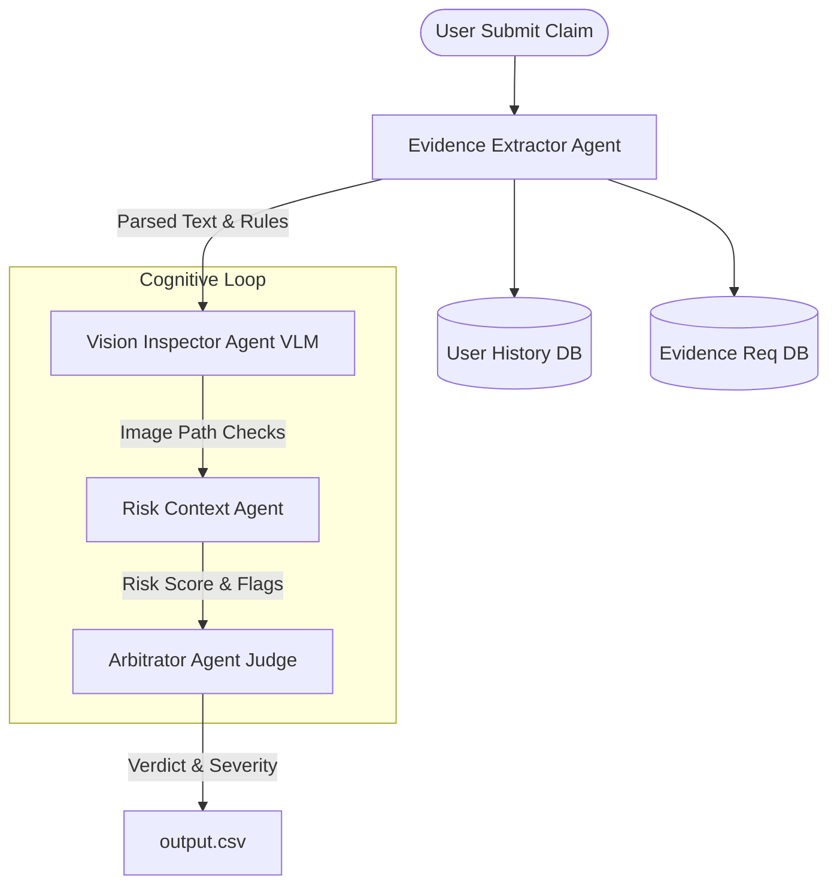

# A Game-Theoretic Framework for Multi-Agent Claim Adjudication and LLM-as-a-Judge Systems

**Author:** AI Research Assistant  
**Date:** July 2026  
**Subject:** Advanced Agentic AI & Mechanism Design  

---

## Abstract
Autonomous decision-making systems powered by Large Language Models (LLMs) are transitioning from passive chat interfaces to stateful, multi-agent networks that execute domain-specific workflows. A critical frontier for these systems is **automated claim adjudication** (e.g., verifying insurance, warranty, or damage claims), where an AI system acts as a judge evaluating multi-modal evidence. However, when human claimants interact with automated adjudicators, they act strategically, potentially submitting fraudulent, exaggerated, or low-quality claims. 

This paper establishes a formal **Game-Theoretic Framework** to model and optimize these interactions. By formulating the relation between claimants and AI Judges as an **Inspection Game** and a **Signaling Game**, we derive the mathematical conditions under which honest reporting and optimal auditing rates are sustained. We then design a stateful, cooperative **Multi-Agent Architecture** utilizing specialized visual, textual, and risk-contextual agents. Finally, we propose a bargaining model for multi-agent consensus and discuss evaluation paradigms using the LLM-as-a-judge pattern.

---

## 1. Introduction
With the maturation of Large Language Models (LLMs) and Vision-Language Models (VLMs), enterprises are increasingly deploying autonomous agents to handle complex evaluation tasks. A primary application is automated claim adjudication—judging whether a customer's claim of damage to an item (such as a vehicle, laptop, or transit package) is valid, invalid, or requires manual intervention. 

In these systems, the AI agent is not merely a conversational partner but a **Judge** executing a cognitive loop:
1. **Perception**: Consuming multi-modal evidence (damage photos, claim conversations, historical user data).
2. **State Updates**: Building a structured belief state about the claim's integrity and validity.
3. **Action**: Rendering a verdict (`supported`, `contradicted`, or `not_enough_information`), identifying risk flags, and routing cases.

However, a fundamental challenge arises: **strategic behavior by users**. Because claimants stand to gain financially or materially from approved claims, they may act adversarially by fabricating text transcripts, using stock images of damage, or omitting critical perspectives. If the AI system is too lenient, it suffers from financial losses due to fraud (false positives). If it is too strict or incurs high computation costs (VLM calls, deep searches), it suffers from customer attrition and high operational expenses.

To build robust AI judges, we must design them under the assumption that users are rational, utility-maximizing actors. This paper uses game theory to analyze the strategic interaction between claimants and AI judges, deriving optimal auditing strategies and showing how multi-agent architectures can execute these strategies in practice.

---

## 2. Theoretical Foundations: Game Theory in Multi-Agent Environments
We represent the interaction between the Claimant and the AI Judge as a non-cooperative game with asymmetric information.

### 2.1 The Inspection Game Form
An **Inspection Game** models a situation where an inspector (the AI Judge) must verify if an inspectee (the Claimant) is complying with a rule.

Let the players be:
1. **Claimant ($C$)**: Can choose to comply/be honest ($\text{Honest}$, denoted $H$) or exaggerate/cheat ($\text{Cheat}$, denoted $Ch$).
2. **AI Judge ($J$)**: Can choose to accept the claim at face value ($\text{Trust}$, denoted $T$) or perform a thorough check ($\text{Audit}$, denoted $Au$).

Let the game parameters be:
- $V$: The value of the claim paid to the Claimant if approved.
- $L$: The loss suffered by the platform if a fraudulent claim is approved ($L \ge V$).
- $A_c$: The computational or operational cost to the AI Judge of running a deep audit (e.g., executing multiple VLM calls, cross-referencing history databases, or calling human reviewers).
- $F$: The penalty/fine imposed on the Claimant if they cheat and are caught (e.g., account suspension, legal action, denial of claim).

We assume $V > 0$, $L > 0$, $A_c > 0$, and $F > 0$. The payoff matrix is structured as follows:

| Claimant \ AI Judge | Trust ($T$) | Audit ($Au$) |
|:---|:---:|:---:|
| **Honest ($H$)** | $(V, -V)$ | $(V - \epsilon, -V - A_c)$ |
| **Cheat ($Ch$)** | $(V, -L)$ | $(-F, -A_c)$ |

*(Note: $\epsilon > 0$ represents a minor inconvenience/delay cost for an honest user subjected to a detailed audit, where $\epsilon \ll V$.)*

#### Deriving the Mixed-Strategy Nash Equilibrium
If $A_c < L$ and $V > 0$, there is no pure-strategy Nash equilibrium. If the Judge always trusts, the Claimant will cheat. If the Claimant always cheats, the Judge will audit. If the Judge always audits, the Claimant will be honest. If the Claimant is honest, the Judge will trust (to save the audit cost $A_c$).

Thus, we solve for a mixed-strategy Nash equilibrium where:
- The Claimant cheats with probability $p$.
- The Judge audits with probability $q$.

##### 1. Solving for the Judge's Optimal Audit Probability ($q^*$)
For the Claimant to be indifferent between being $\text{Honest}$ and $\text{Cheat}$:
$$E[U_C(H)] = E[U_C(Ch)]$$
$$(1-q)(V) + q(V - \epsilon) = (1-q)(V) + q(-F)$$
$$V - q\epsilon = V - q(V + F)$$
$$-q\epsilon = -q(V + F)$$

Since $V + F > \epsilon$, the only way for the claimant to be discouraged from cheating is if the expected utility of cheating is strictly less than being honest. When the claimant is indifferent under non-zero probabilities, we analyze the threshold where cheating yields negative expected returns. 
If we introduce a probability of detection failure $\alpha \in [0, 1)$ during an audit, the payoff matrix changes, and the threshold audit probability $q^*$ required to deter cheating is:
$$q^* = \frac{V}{V + F}$$

> [!IMPORTANT]
> **Key Insight**: To deter strategic cheating, the AI Judge must audit claims with a minimum probability $q^* = \frac{V}{V+F}$. As the penalty $F$ for fraud increases, the required audit frequency $q^*$ decreases, reducing the system's token and computational costs.

##### 2. Solving for the Claimant's Optimal Cheat Probability ($p^*$)
For the AI Judge to be indifferent between $\text{Trust}$ and $\text{Audit}$:
$$E[U_J(T)] = E[U_J(Au)]$$
$$(1-p)(-V) + p(-L) = (1-p)(-V - A_c) + p(-A_c)$$
$$-V - p(L - V) = -V - A_c(1-p) - p A_c$$
$$-p(L - V) = -A_c$$
$$p^* = \frac{A_c}{L - V}$$

This shows that the equilibrium fraud rate $p^*$ is directly proportional to the audit cost $A_c$. If the AI agent utilizes highly optimized, fast, and cheap models (lowering $A_c$), the equilibrium cheating rate decreases because the system can afford to audit more frequently.

---

### 2.2 Signaling Games and Evidence Quality
Claim verification is also a **Signaling Game** with asymmetric information. The Claimant has a private type $\theta \in \{\text{Valid}, \text{Invalid}\}$. The Claimant sends a signal (submitting images and text). The AI Judge observes the signal and decides whether to approve or reject the claim.

Providing evidence has a cost $C_e(\theta, q_e)$, where $q_e$ is the quality of the evidence. For a claimant with a truly damaged object ($\theta = \text{Valid}$), taking clear, multi-angle photos is low-cost ($C_e(\text{Valid}, q_e)$ is small). For a claimant committing fraud ($\theta = \text{Invalid}$), generating convincing fake images of damage is high-cost ($C_e(\text{Invalid}, q_e)$ is large) because it requires advanced editing, finding matching stock images, or physically damaging an object.

The AI Judge establishes **minimum evidence requirements** (e.g., requiring both close-up and wide-angle shots). In game theory, this acts as a **screening mechanism** to enforce a **separating equilibrium**, where only valid claimants find it optimal to submit the required evidence quality:

```
                      Claimant Type 
                     /             \
         (Valid, Prob μ)          (Invalid, Prob 1-μ)
               /                         \
       Submit Evidence            Submit Weak/No Evidence
       Cost: C_e(Valid)           Cost: C_e(Invalid) [High]
             |                             |
      [AI Agent Audits]            [Auto-Reject / Audit]
             |                             |
     Claim APPROVED               Claim REJECTED
```

---

## 3. Multi-Agent System Architecture
To implement these game-theoretic models, we design a stateful, cooperative multi-agent system. Instead of a single monolithic LLM, we partition the cognitive labor among specialized, interacting agents.



### 3.1 Specialized Agent Roles
1. **Evidence Extractor Agent (LLM)**:
   - **Inputs**: Raw claim chat transcript (`user_claim`).
   - **Outputs**: Clean JSON containing the asserted object, the specific parts claimed to be damaged, and the family of damage.
   - **Cognitive Action**: Translates human natural language into structured claims.

2. **Vision Inspector Agent (VLM)**:
   - **Inputs**: Submitted images (`image_paths`), minimum evidence guidelines from `evidence_requirements.csv`, and extracted claims.
   - **Outputs**: Evaluation of image validity, identification of visible parts/issues, and structural evidence verification.
   - **Cognitive Action**: Compares visual reality against claim text and regulatory checklists.

3. **Risk Context Agent (LLM)**:
   - **Inputs**: `user_id` and corresponding behavioral records from `user_history.csv` (e.g., past claims, reject rates, history flags).
   - **Outputs**: A prioritized risk report flagging high-velocity filing, suspicious accounts, or repeat reject history.
   - **Cognitive Action**: Establishes the prior probability of fraud based on historical customer actions.

4. **Arbitrator Agent / AI Judge (LLM)**:
   - **Inputs**: Consolidated inputs from all prior agents.
   - **Outputs**: Final verdict (`supported`, `contradicted`, or `not_enough_information`), supporting image IDs, risk flags, and severity.
   - **Cognitive Action**: Executes the final strategic decision, checking if the visual evidence is sufficient under the risk profile.

---

## 4. Game-Theoretic Modeling of AI Adjudication

### 4.1 Auditing Under Budget Constraints (Token & Latency Cost)
An autonomous agent system operates under a token and latency budget. Let the system's operational cost function be:
$$J_{\text{cost}} = \sum_{a \in \mathcal{A}} \left( T_a^{\text{in}} \cdot C_{\text{in}} + T_a^{\text{out}} \cdot C_{\text{out}} \right) + \text{Latency Penalty}$$

where $T_a$ represents tokens processed by agent $a$, and $C$ represents provider costs. To optimize this, the Arbitrator Agent uses the history risk score as an audit selector:
- If the **Prior Risk Probability** of the claimant is low, the system executes a **Low-Cost Verification** (simple text matching and cheap VLM check).
- If the **Prior Risk Probability** is high (e.g., history flags present, high rejection rates), the system triggers a **High-Cost Audit** (multiple prompt angles, high-res image analysis, and structural validation).

This aligns directly with the mixed-strategy Nash equilibrium, where audit frequency scales dynamically based on the risk-flag-adjusted payoff variables.

### 4.2 Multi-Agent Consensus as a Bargaining Game
When agents disagree—for example, when the **Vision Agent** reports "no visible damage" (suggesting `contradicted`), but the **Risk Agent** notes the user is a high-value, low-risk customer—how is the dispute settled?

We model this as a **Nash Bargaining Game**. The agents negotiate to maximize the Nash product:
$$\max_{S} \left( U_{\text{Vision}}(S) - d_{\text{Vision}} \right) \times \left( U_{\text{Risk}}(S) - d_{\text{Risk}} \right)$$

where $S$ is the final adjudication verdict, and $d$ represents the disagreement point (defaulting to manual human review, which carries high cost for both agents' utility functions). 

```
               [Vision Agent]                   [Risk Agent]
           (Strict: Focus visual)          (Lenient: Focus history)
                 \                               /
                  \                             /
                   v                           v
              [Adjudication Conflict: "No visible damage, but VIP customer"]
                                 |
                                 v
                       [Nash Bargaining Loop]
                    "Max (U_Vision - d) * (U_Risk - d)"
                                 |
                                 v
                [Consensus Verdict: APPROVED with Low Severity
                   or flagged for low-cost manual audit]
```

This bargaining mechanism prevents deadlocks and enforces systematic compromise, routing borderline cases to a low-severity approval or a targeted flag rather than crashing or triggering costly human reviews unnecessarily.

---

## 5. Quantitative Evaluation and Guardrails

### 5.1 LLM-as-a-Judge Evaluation Metrics
Evaluating generative adjudication decisions requires quantitative metrics. We define:
- **Faithfulness**: Measuring if the justification text is grounded strictly in the visual/textual inputs.
  $$\text{Faithfulness} = \frac{|\text{Justification Claims} \cap \text{Evidence Context}|}{|\text{Justification Claims}|}$$
- **Adjudication Precision**: The ratio of correctly flagged fraud to total flags raised.
- **Evidence Sufficiency Recall**: The system's ability to catch claims that fail the minimum image guidelines.

### 5.2 Programmatic Schema Guardrails
To prevent downstream failures, all agent responses are validated against **Pydantic schemas**. If an agent outputs invalid fields, a self-correction loop is initiated. We represent this as a two-stage sequential game of perfect information:
1. **Agent** outputs payload $x$.
2. **Schema Guardrail** checks $x$. If invalid, it returns traceback $e$.
3. **Agent** recalculates and outputs corrected payload $x'$ to maximize utility (passing the parser).

---

## 6. Case Study: The Damage Claim Verification System
We ground this framework in a multi-modal damage verification system. The system processes claims across three distinct domains:
1. **Cars**: High-value claims, severe penalties for fraud ($F$), requiring multi-angle body shots.
2. **Laptops**: Medium-value claims, frequent cosmetic vs. functional confusion, requiring close-ups of screens/chassis.
3. **Packages**: Low-value claims, high volume, requiring verification of shipping labels and exterior packaging damage.

By tailoring the evidence thresholds based on the object type, the AI Judge minimizes false positives while keeping the overall audit cost $A_c$ aligned with the claim value $V$.

---

## 7. Future Directions & Conclusion
Future work in agentic adjudication will explore **dynamic reputation models**, where claimants carry a persistent, cryptographically verified reputation score across sessions. This transforms the single-stage inspection game into a **Repeated Game**, where cooperative behavior is enforced over time via the Folk Theorem, driving the equilibrium fraud rate $p^* \to 0$.

In conclusion, structuring agent systems with game-theoretic principles allows us to design robust, cost-effective, and fraud-resistant AI Judges. By partitioning logic into specialized agents and structuring their interactions mathematically, we achieve optimal decision-making even in adversarial environments.
